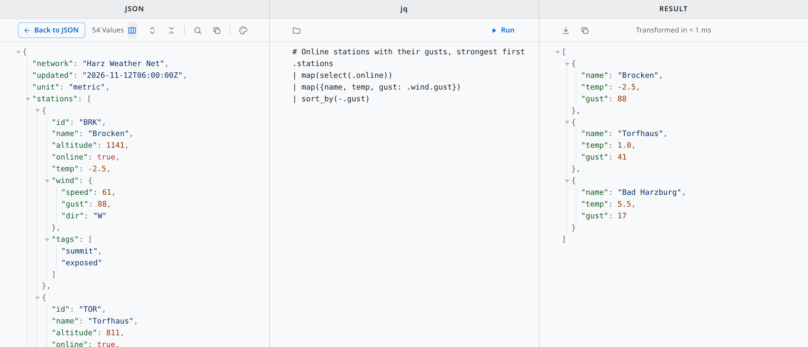

# Qiew

**One small viewer per file type.**

Quick viewers for Linux: small, read-only, one file at a time. They open what you drop on them or
double-click, show it nicely, follow the file when it changes – and never write to it.

**Website:** https://be-spex.github.io/#qiew · part of [be spex](https://be-spex.github.io) – small, focused apps for Linux

| App | Shows | |
| --- | --- | --- |
| [Marq](apps/marq/README.md) | Markdown, rendered | links, images, back/forward |
| [Xaq](apps/xaq/README.md) | XML source, pretty-printed and foldable | XSLT mapping view |
| [Jayq](apps/jayq/README.md) | JSON source, pretty-printed and foldable | jq filter view |

All of them: search (Ctrl+F), copy, four colour schemes, live reload, file association.

<picture>
  <source media="(prefers-color-scheme: dark)" srcset="apps/jayq/docs/images/jayq-split-dark.png">
  
</picture>

## Install

### With APT (Debian, Ubuntu, Linux Mint)

Once, add the be spex repository:

```sh
curl -fsSLO https://be-spex.github.io/packages/be-spex-archive-keyring.deb
sudo apt install ./be-spex-archive-keyring.deb && sudo apt update
```

Then:

```sh
sudo apt install marq xaq jayq
```

Updates arrive with `sudo apt upgrade`.

### AppImage

Each app has its own AppImage in the [releases](https://github.com/be-spex/Qiew/releases) (tags `marq-v…`,
`xaq-v…`, `jayq-v…`). It runs as it is and updates itself; see the README of the app for details.

### Other ways

Take the `.deb` of an app from its release and run `sudo apt install ./<app>_*_amd64.deb`.

Requirements: Ubuntu 24.04+, Linux Mint 22+ or Debian 13+ (x86_64).

## Build from source

Tauri 2 + Vanilla TypeScript; one npm workspace and one Cargo workspace for all apps.

```sh
npm install
npm run tauri --workspace apps/xaq -- dev -- -- path/to/file.xml   # development
npm run tauri --workspace apps/xaq -- build                        # .deb and AppImage (Linux)
npm run check                                                       # type-check and build everything
```

## Layout

```
apps/<app>/            an app: index.html, src/ (frontend), src-tauri/ (backend, window, bundle)
packages/frame/        @qiew/frame – frontend shared by the apps
crates/frame/          qiew-frame – backend shared by the apps
tools/screenshots/     takes the screenshots for the READMEs and the website
.github/workflows/     release.yml: builds and publishes one app per tag
```

The frame is what makes a new viewer cheap:

- `packages/frame`: colour schemes (`views`), toolbar and copy (`toolbar`), search (`search`), page and
  toolbar styles (`base.css`); for source views also the markup fragments (`fragment`), folding (`fold`),
  the viewer itself – open, drop, live reload, history – (`viewer`), the split view with editor and result
  (`split`) and their styles (`source.css`). An app adds its parser and highlighter.
- `crates/frame`: window placement and widening, file watcher, reading text in any encoding,
  default-handler registration, moving the directories of an old identifier, AppImage update check.

## Release

Each app has its own version and its own tag. Bump the version in `apps/<app>/package.json`,
`apps/<app>/src-tauri/tauri.conf.json` and `apps/<app>/src-tauri/Cargo.toml`, commit, then

```sh
git tag xaq-v<version> && git push origin xaq-v<version>
```

[`release.yml`](.github/workflows/release.yml) builds the app, publishes the release `xaq-v<version>` and
updates `xaq.json` in the release `updater`, which is where the AppImages look for a newer version.
The package repository picks up the `.deb` within half an hour.

Marq and Xaq started in repositories of their own; their history is part of this one (tags `marq-v*`, `xaq-v*`).

## License

MIT – see [LICENSE](LICENSE).
