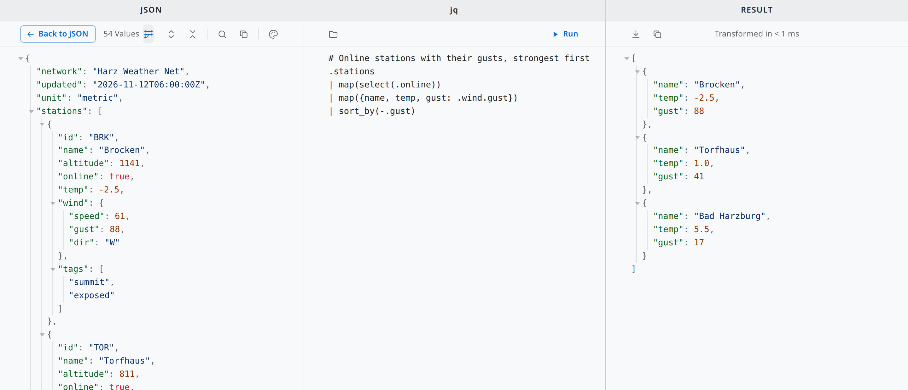

# Qiew

**One small viewer per file type.**

Quick viewers for Linux: small, read-only, one file at a time. They open what you drop on them or
double-click, show it nicely, follow the file when it changes – and never write to it.

**Website:** https://be-spex.github.io/#qiew · part of [be spex](https://be-spex.github.io) – small, focused apps for Linux

| App | Shows | |
| --- | --- | --- |
| [Trisq](apps/trisq/README.md) | TSX/JSX: a React component, running – no Node.js, no project | Tailwind, imports, live reload, error display |
| [Marq](apps/marq/README.md) | Markdown, rendered | links, images, back/forward |
| [Jayq](apps/jayq/README.md) | JSON source, pretty-printed and foldable | jq filter view |
| [Xaq](apps/xaq/README.md) | XML source, pretty-printed and foldable | XSLT mapping view |

Built, not released yet (they work from source; each README says what they do): [Hyqe](apps/hyqe/README.md) for
HTML pages, [Cusq](apps/cusq/README.md) for CSV tables, [Dirq](apps/dirq/README.md) for diffs and patches,
[Maiqe](apps/maiqe/README.md) for Mermaid diagrams.

All of them: copy, live reload, file association. Marq, Xaq and Jayq also search (Ctrl+F) and have four colour
schemes; Trisq takes its colours and its width from the component.

<picture>
  <source media="(prefers-color-scheme: dark)" srcset="apps/jayq/docs/images/jayq-split-dark.png">
  
</picture>

## Install

### With APT (Debian, Ubuntu, Linux Mint)

Once, add the be spex repository:

```sh
curl -fsSLO https://be-spex.github.io/packages/be-spex-archive-keyring.deb
sudo apt install ./be-spex-archive-keyring.deb && sudo apt update
```

Then:

```sh
sudo apt install trisq marq jayq xaq
```

Updates arrive with `sudo apt upgrade`.

### AppImage

Each app has its own AppImage in the [releases](https://github.com/be-spex/Qiew/releases) (tags `trisq-v…`,
`marq-v…`, `jayq-v…`, `xaq-v…`). It runs as it is and updates itself; see the README of the app for details.

### Other ways

Take the `.deb` of an app from its release and run `sudo apt install ./<app>_*_amd64.deb`.

Requirements: Ubuntu 24.04+, Linux Mint 22+ or Debian 13+ (x86_64).

## Build from source

Tauri 2 + Vanilla TypeScript; one npm workspace and one Cargo workspace for all apps.

```sh
npm install
npm run tauri --workspace apps/xaq -- dev -- -- path/to/file.xml   # development
npm run tauri --workspace apps/xaq -- build                        # .deb and AppImage (Linux)
npm run check                                                       # type-check and build everything
```

## Layout

```
apps/<app>/            an app: index.html, src/ (frontend), src-tauri/ (backend, window, bundle)
packages/frame/        @qiew/frame – frontend shared by the apps
crates/frame/          qiew-frame – backend shared by the apps
tools/screenshots/     takes the screenshots for the READMEs and the website
.github/workflows/     release.yml: builds and publishes one app per tag
```

The frame is what makes a new viewer cheap:

- `packages/frame`: colour schemes (`views`), toolbar and copy (`toolbar`), About box (`about`), export button (`export`), search (`search`), page and
  toolbar styles (`base.css`); for source views also the markup fragments (`fragment`), folding (`fold`),
  the viewer itself – open, drop, live reload, history – (`viewer`), the split view with editor and result
  (`split`) and their styles (`source.css`). An app adds its parser and highlighter.
- `crates/frame`: the command line (`launch`), window placement and widening, file watcher, reading text in any encoding, export
  (button, save dialog and writing; an app only says what its export is),
  default-handler registration, moving the directories of an old identifier, AppImage update check.

## Command line

Every viewer understands the same command line, so a script or another program can drive it:

```sh
<app> [<file> | -] [--line <n>] [--geometry <W>x<H>+<X>+<Y>] [--reuse]
```

| | |
| --- | --- |
| `<file>` | the file to show |
| `-` | read the document from standard input: `git diff \| dirq -`, `curl -s … \| jayq -` |
| `--line <n>` | show that line of the file and mark it for a moment. Xaq and Jayq re-indent, so they find the line by what it says; Marq shows the block that holds it; Trisq has no lines to show. |
| `--geometry` | place the window: content size and position in physical pixels; either part may be left out (`900x700`, `+40+60`) |
| `--reuse` | hand the file to a window that was started with `--reuse` before, if one is open, instead of opening another; it comes to the front. Windows started without it are left alone. `<app> --reuse --line 40` shows a line of the file that window already has. |
| `--register-default` | make the app the default for its files, without asking |
| `--help`, `-h`, `-?` | print what the program is, how it is called and what it can do, then exit |
| `--version` | print the version, then exit |

Standard input is kept as a file of the app's own in the runtime directory (`$XDG_RUNTIME_DIR/<app>/`) and
removed when the window is closed; the files a viewer shows are never written to.

## Working with CodeDeck

Every viewer is a program of its own and stays one. [CodeDeck](https://github.com/be-spex), the be spex
coding deck, leaves viewing files to such programs; this is how the two meet without depending on each other.

- **Found through the desktop** – CodeDeck offers the programs installed for a file type ("View with…") and
  remembers one per kind of file. A viewer's desktop entry and file types are all it needs to be on that list.
- **Driven through the command line** (above) – `--reuse` keeps one window per viewer while stepping through
  files, `--line` jumps to a place, `--geometry` puts the window beside CodeDeck's own, and `-` shows what
  CodeDeck has only in memory, such as a diff.

Planned, in the frame so every viewer gets it at once:

- **A channel back, only when asked for** – CodeDeck starts a viewer with `CODEDECK_SOCKET=<path>` in its
  environment. Only then the toolbar shows "Send to CodeDeck", which hands over what is selected (a passage,
  an error, rows, a hunk) as one line of JSON:
  `{"action":"add_to_context","source":"<app>","file":"<path>","selector":"<what>","content":"<text>"}`.
  Without the variable there is no button and no connection.

CodeDeck's part: start the viewers with these options, listen on the socket and set the variable, and prefer
the be spex viewers in its list.

## Release

Each app has its own version and its own tag. Bump the version in `apps/<app>/package.json`,
`apps/<app>/src-tauri/tauri.conf.json` and `apps/<app>/src-tauri/Cargo.toml`, commit, then

```sh
git tag xaq-v<version> && git push origin xaq-v<version>
```

[`release.yml`](.github/workflows/release.yml) builds the app, publishes the release `xaq-v<version>` and
updates `xaq.json` in the release `updater`, which is where the AppImages look for a newer version.
The package repository picks up the `.deb` within half an hour.

Marq and Xaq started in repositories of their own; their history is part of this one (tags `marq-v*`, `xaq-v*`).

## License

MIT – see [LICENSE](LICENSE).
