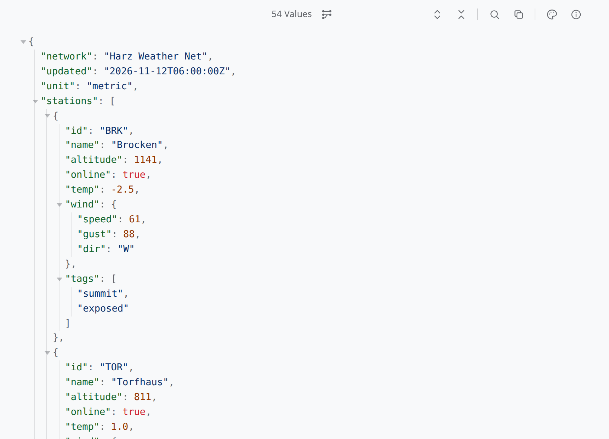
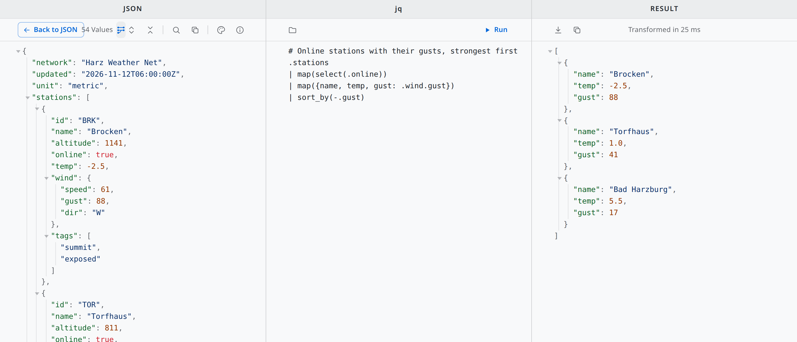

# Jayq

**JSON at a glance – and jq filters when you want to dig.**

Jayq (read: Jake) lays out JSON as a coloured, foldable tree and keeps every value exactly as it was
written. To dig deeper, type a jq filter and see the result next to the data – jq is built in. It is a
read-only viewer: nothing is evaluated except a jq filter you run yourself.

**Website:** https://be-spex.github.io/jayq/ · part of [be spex](https://be-spex.github.io) – small, focused apps for Linux

<picture>
  <source media="(prefers-color-scheme: dark)" srcset="docs/images/jayq-dark.png">
  
</picture>

The filter view: the JSON, your jq filter and the result side by side.

<picture>
  <source media="(prefers-color-scheme: dark)" srcset="docs/images/jayq-split-dark.png">
  
</picture>

## Install

### With APT (Debian, Ubuntu, Linux Mint)

Once, add the be spex repository:

```sh
curl -fsSLO https://be-spex.github.io/packages/be-spex-archive-keyring.deb
sudo apt install ./be-spex-archive-keyring.deb && sudo apt update
```

Then:

```sh
sudo apt install jayq
```

Updates arrive with `sudo apt upgrade`.

### AppImage

Download `Jayq_*_amd64.AppImage` from the [latest Jayq release](https://github.com/be-spex/Qiew/releases?q=jayq-v),
make it executable (`chmod +x Jayq_*_amd64.AppImage`) and start it.

Jayq updates itself: it checks for a newer version and offers to replace the AppImage in place. That update
is built into Jayq and does not use zsync, so tools that rely on AppImageUpdate cannot update it.

An AppImage has no menu entry of its own. To get one (and a file association), use an AppImage manager such
as [Gear Lever](https://flathub.org/apps/it.mijorus.gearlever),
[AppImageLauncher](https://github.com/TheAssassin/AppImageLauncher) or
[appimaged](https://github.com/probonopd/go-appimage). With APT you get both without extra tools.

### Other ways

Take the `.deb` from the same release and run `sudo apt install ./jayq_*_amd64.deb`.

Requirements: Ubuntu 24.04+, Linux Mint 22+ or Debian 13+ (x86_64).

## Features

- **A tree you can scan** – keys, strings, numbers and literals each have their colour; objects and arrays fold.
- **Nothing gets rounded** – large integers, `1.0` versus `1`, key order, even duplicate keys: Jayq shows what
  is in the file, not what a parser made of it.
- **JSON Lines** – several values in one file (JSON Lines, the output of jq) are shown one after the other.
- **jq filter view** – JSON, your filter and the result side by side. Run with Ctrl+Enter, load a `.jq` file,
  save or copy the result. No jq installation needed.
- **Runaway filters are stopped** – a filter runs in its own process and is ended after ten seconds, so the
  viewer always stays responsive.
- **Precise error messages** – if a file is not valid JSON, you get line, column and what was expected, and
  the text as written.
- **Live reload** – when another program changes the file (including atomic saves), Jayq follows. Fold state
  survives.
- **Search, copy, colour schemes** – Soft Light, Soft Dark, Sepia and Slate / Nord; the choice is kept.
- **Read-only** – the files shown are only read, never written. The only writes are saving a filter result to a
  file you choose and the AppImage replacing itself when you accept an update.

## Usage

- **Open a file:** drag it onto the window, pass it on the command line (`jayq data.json`) or double-click
  it. Jayq handles `.json`, `.jsonl`, `.ndjson` and `.geojson`. On first start it asks whether it should be
  your default viewer for JSON, naming the app it would replace; later, run `jayq --register-default`.
  Answering no also means it will not ask again; to be asked once more, delete
  `~/.config/net.spex.jayq/default-handler-declined`.
- **Fold:** click the triangle (or the `…` of a folded node); Alt+click folds the whole subtree. The toolbar
  expands or collapses everything (the outermost level stays open).
- **Search:** Ctrl+F, then ↑/↓, Enter/Shift+Enter or F3. Matches in folded nodes unfold them.
- **Copy:** the toolbar copies the formatted JSON.
- **Filter view:** the button next to the value count widens the window to the full screen width and splits it
  into JSON | jq | Result. The jq column starts with the identity filter `.` and is editable (Tab indents).
  Run or Ctrl+Enter applies the filter to every value of the input; the result column shows all outputs and
  the duration. Click the button again to restore the previous window size and position in the JSON.
- **Encodings:** UTF-8, or UTF-16 / UTF-8 with BOM.
- **If the input is not valid JSON** (comments, trailing commas, single quotes …), the original text is shown
  unchanged, only highlighted, with a banner naming line, column and what was expected.

## The jq engine

The filter runs in [jaq](https://github.com/01mf02/jaq), a jq implementation in Rust that is built into
`jayq` – no `jq` needs to be installed. jaq covers the jq language and nearly all of its standard library;
its README lists the differences, which are in corner cases. Numbers pass through unchanged (`1.50` stays
`1.50`, large integers keep all digits). Not available: `input`/`inputs`, `$ENV`, modules and command-line
options such as `--slurp` or `--arg`.

A filter never runs inside the viewer: `jayq` starts itself a second time as a worker
(`jayq --jq-worker <filter>`, JSON on stdin). A filter that does not end is stopped after 10 seconds or as
soon as the next run starts, endless recursion only takes the worker down, and more than 64 MB of output is
not shown.

## Build from source

Jayq is part of the [Qiew](../../README.md) monorepo; see there for requirements, building and releasing.

```sh
npm install
npm run tauri --workspace apps/jayq -- dev -- -- path/to/file.json
```

Layout: `src/json.ts` (parse, pretty print, highlighting, raw fallback), `src/filter.ts` (jq for the split
view), `src/main.ts` (wiring), `src-tauri/src/jq.rs` (jq engine, worker process), `src-tauri/src/lib.rs`
(commands), `src-tauri/tauri.conf.json` (window, CSP, file association). Everything else comes from the
frame. The app icon's SVG source is `src-tauri/icons/icon.svg`.

## License

MIT – see [LICENSE](../../LICENSE). jq filters run in [jaq](https://github.com/01mf02/jaq) (MIT).
