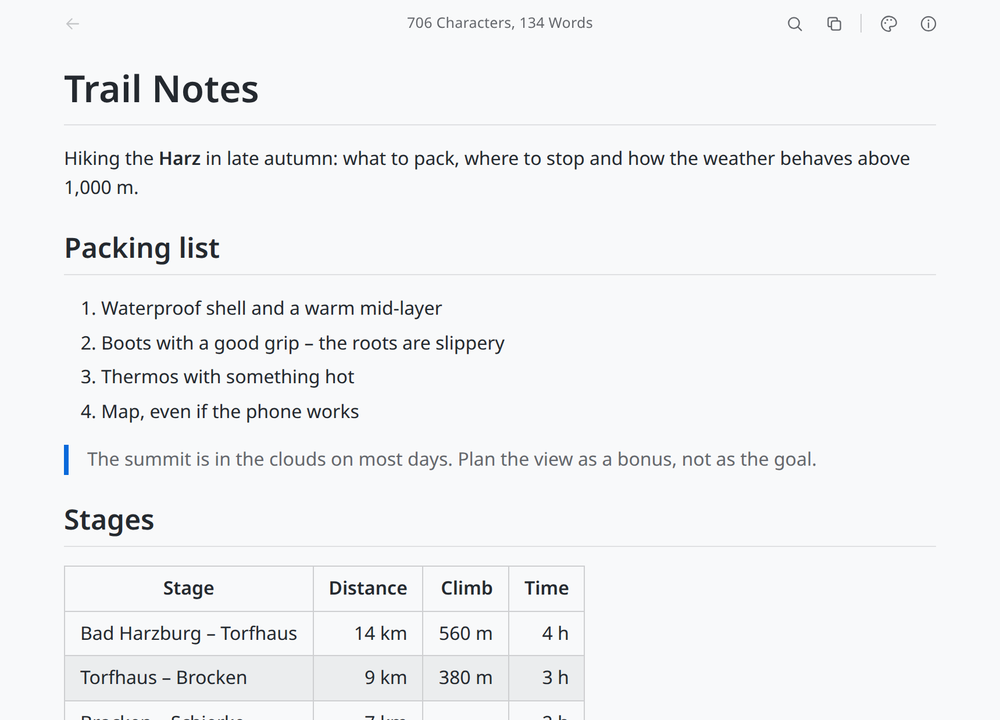

# Marq

**Markdown files, beautifully rendered – just to read.**

Marq turns a Markdown file into a clean, readable page: headings, tables, code, images. Follow links to other
documents and step back, like in a browser. It is a read-only viewer: it never writes to your files.

**Website:** https://be-spex.github.io/marq/ · part of [be spex](https://be-spex.github.io) – small, focused apps for Linux

<picture>
  <source media="(prefers-color-scheme: dark)" srcset="docs/images/marq-dark.png">
  
</picture>

## Install

### With APT (Debian, Ubuntu, Linux Mint)

Once, add the be spex repository:

```sh
curl -fsSLO https://be-spex.github.io/packages/be-spex-archive-keyring.deb
sudo apt install ./be-spex-archive-keyring.deb && sudo apt update
```

Then:

```sh
sudo apt install marq
```

Updates arrive with `sudo apt upgrade`.

### AppImage

Download `Marq_*_amd64.AppImage` from the [latest Marq release](https://github.com/be-spex/Qiew/releases?q=marq-v),
make it executable (`chmod +x Marq_*_amd64.AppImage`) and start it.

Marq updates itself: it checks for a newer version and offers to replace the AppImage in place. That update
is built into Marq and does not use zsync, so tools that rely on AppImageUpdate cannot update it.

An AppImage has no menu entry of its own. To get one (and a file association), use an AppImage manager such
as [Gear Lever](https://flathub.org/apps/it.mijorus.gearlever),
[AppImageLauncher](https://github.com/TheAssassin/AppImageLauncher) or
[appimaged](https://github.com/probonopd/go-appimage). With APT you get both without extra tools.

### Other ways

Take the `.deb` from the same release and run `sudo apt install ./marq_*_amd64.deb`.

Requirements: Ubuntu 24.04+, Linux Mint 22+ or Debian 13+ (x86_64).

## Features

- **A page, not a source file** – headings, lists, tables, quotes and code blocks in a comfortable reading
  column; images next to the file are shown.
- **Links work** – links to other Markdown files open in place, web links go to your browser, anchors jump
  within the document.
- **Back and forward** – toolbar, context menu, Alt+←/→ or the mouse buttons take you back through the
  documents you followed.
- **Copy the source** – one click puts the Markdown itself on the clipboard.
- **Live reload** – when another program changes the file (including atomic saves), Marq follows.
- **Search and colour schemes** – Ctrl+F with match count; Soft Light, Soft Dark, Sepia and Slate / Nord, the
  choice is kept.
- **Read-only** – files are only read, nothing is ever written (except the AppImage replacing itself when
  you accept an update).

## Usage

- **Open a file:** drag it onto the window, pass it on the command line (`marq README.md`) or double-click
  it. Marq handles `.md` and `.markdown`. On first start it asks whether it should be your default viewer for
  Markdown, naming the app it would replace; later, run `marq --register-default` (uses `xdg-mime`; works on
  Cinnamon, KDE and GNOME). Answering no also means it will not ask again; to be asked once more, delete
  `~/.config/net.spex.marq/default-handler-declined`.
- **Toolbar:** back on the left, character and word count in the centre, search, copy, colour scheme and
  About on the right.
- **Search:** Ctrl+F or the toolbar icon, then ↑/↓, Enter/Shift+Enter or F3; Esc closes.
- **Back and forward:** Alt+←/→, the mouse buttons, the toolbar or the context menu.

## Build from source

Marq is part of the [Qiew](../../README.md) monorepo; see there for requirements, building and releasing.

```sh
npm install
npm run tauri --workspace apps/marq -- dev -- -- path/to/file.md
```

Built with Tauri 2, TypeScript, markdown-it and github-markdown-css. Layout: `src/main.ts` (rendering, drag &
drop, links), `src-tauri/src/lib.rs` (commands), `src-tauri/tauri.conf.json` (window, CSP, asset scope, file
association). Toolbar, search, colour schemes, watcher and window handling come from the frame.

## License

MIT – see [LICENSE](../../LICENSE).
