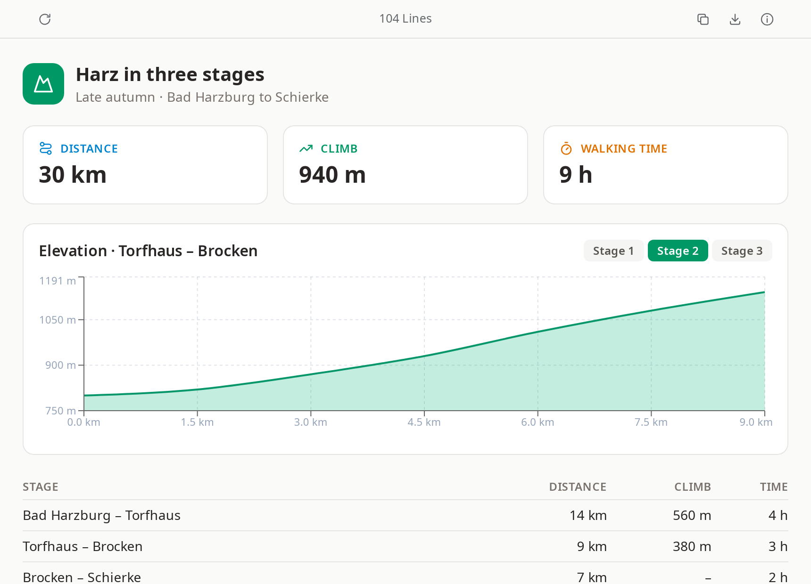

# Tusq

**TSX and JSX components, running – just to look at.**

Tusq shows what a `.tsx` or `.jsx` file renders: open a React component – a prototype an AI assistant wrote,
a single screen, a chart – and see it live, without a project, Node.js or a dev server. It is a read-only
viewer: it never writes to your files.

**Website:** https://be-spex.github.io/#qiew · part of [be spex](https://be-spex.github.io) – small, focused apps for Linux

<picture>
  <source media="(prefers-color-scheme: dark)" srcset="docs/images/tusq-dark.png">
  
</picture>

## Features

- **Just the file** – TypeScript and JSX are translated in memory (oxc, a few milliseconds); React, Tailwind
  CSS, `lucide-react` and `recharts` are built in and work offline.
- **Files next to it** – relative imports of other components, style sheets, JSON and images work, as does
  the alias `@/…`.
- **Other packages** – anything else is fetched from [esm.sh](https://esm.sh) when a file imports it (needs a
  network connection) and shares the built-in React.
- **Live reload** – when another program changes the file or one it imports (including atomic saves), Tusq
  follows and keeps the scroll position.
- **Errors where they are** – syntax errors with file, line and the lines around it; missing imports and
  errors while rendering are shown instead of a blank page.
- **Copy the source** – one click puts the file's text on the clipboard.
- **Export as HTML** – one file that runs in any browser, without Tusq: the component, the files it imports
  and the built-in packages it uses, Tailwind included. Works offline; only packages that Tusq itself fetches
  from esm.sh stay links.
- **Fits the component** – the window opens as wide as the component is made for (its widest part with a
  maximum width, such as a centred column); a layout that takes any width gets 1280 px. The toolbar takes on
  the colour of the page, so there is no colour scheme to choose.
- **Read-only and apart** – files are only read; the only thing Tusq writes is an export, where you say. The component runs in a frame of its own: it gets no access
  to the app, only to files of its own project folder, and cannot call the network apart from loading
  packages, images, fonts and styles.

## Usage

- **Open a file:** drag it onto the window, pass it on the command line (`tusq App.tsx`) or double-click
  it. Tusq handles `.tsx` and `.jsx`. On first start it asks whether it should be your default viewer for
  them, naming the app it would replace; later, run `tusq --register-default`. Answering no also means it will
  not ask again; to be asked once more, delete `~/.config/net.spex.tusq/default-handler-declined`.
- **What is shown:** the default export of the file; without one, the first exported component. A file that
  mounts itself into `#root` works too.
- **Toolbar:** reload (F5) on the left, line count in the centre, copy, export and About on the right.
- **Export:** the toolbar button asks where to save; `tusq App.tsx --export-html App.html` does the same
  without a window. The exported page is a snapshot: it does not follow the file, and in a browser the
  component is not kept apart as it is in Tusq. Images that the component names by a relative path in the
  markup (rather than importing them) are not included.
- **Project folder:** the nearest directory above the file with a `package.json` or `.git`, else the file's
  own directory. Imports may reach anywhere inside it, not outside.

## Build from source

Tusq is part of the [Qiew](../../README.md) monorepo; see there for requirements, building and releasing.

```sh
npm install
npm run tauri --workspace apps/tusq -- dev -- -- apps/tusq/examples/claude_code_ai_coding_oekosystem.tsx
```

Built with Tauri 2, TypeScript, oxc, React and Tailwind CSS. Layout:

- `src/main.ts` – the window: toolbar, drag & drop, the preview frame
- `runtime/host.ts` – runs inside the frame: mounts the component, shows errors; `runtime/build.mjs` bundles
  it with the built-in packages into `dist/runtime/`
- `src-tauri/src/protocol.rs` – `tusq://localhost/…`, the address the frame loads everything from;
  `transpile.rs` (oxc), `watch.rs` (live reload), `export.rs` (HTML export), `lib.rs` (commands)

Toolbar, export button and dialog, and window handling come from the frame.

## License

MIT – see [LICENSE](../../LICENSE).
