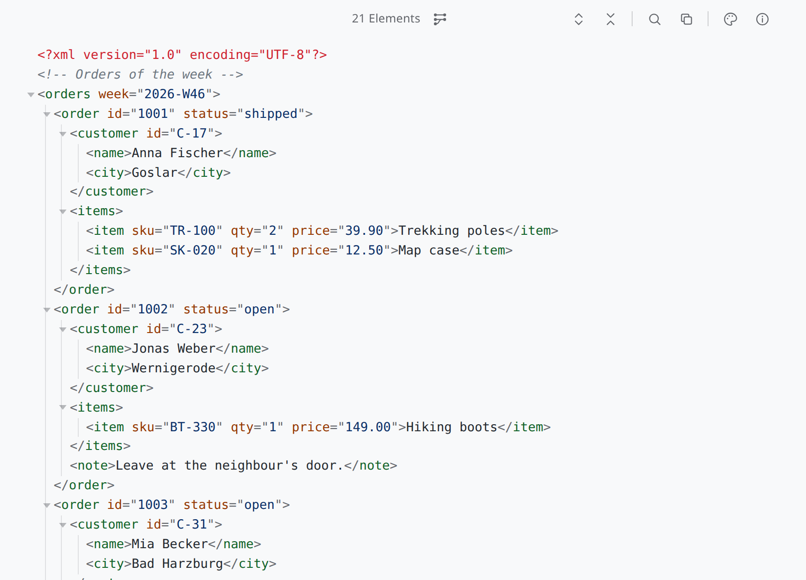
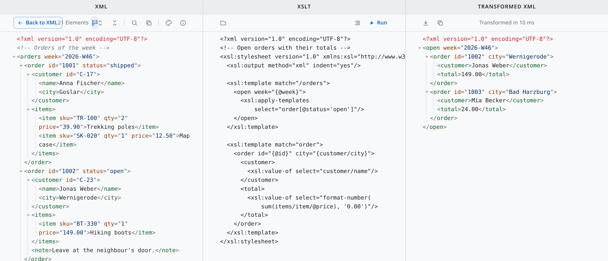

# Xaq

**XML you can actually read: indented, coloured, foldable.**

Xaq (read: Zack) shows XML the way you wish it had been written: re-indented, syntax-coloured and foldable,
whatever the file looked like. Need a different shape? Run an XSLT on it in the mapping view. It is a
read-only viewer: nothing is rendered or executed except an XSLT you run yourself.

**Website:** https://be-spex.github.io/xaq/ · part of [be spex](https://be-spex.github.io) – small, focused apps for Linux

<picture>
  <source media="(prefers-color-scheme: dark)" srcset="docs/images/xaq-dark.png">
  
</picture>

The mapping view: the XML, your XSLT and the result side by side.

<picture>
  <source media="(prefers-color-scheme: dark)" srcset="docs/images/xaq-split-dark.png">
  
</picture>

## Install

### With APT (Debian, Ubuntu, Linux Mint)

Once, add the be spex repository:

```sh
curl -fsSLO https://be-spex.github.io/packages/be-spex-archive-keyring.deb
sudo apt install ./be-spex-archive-keyring.deb && sudo apt update
```

Then:

```sh
sudo apt install xaq
```

Updates arrive with `sudo apt upgrade`.

### AppImage

Download `Xaq_*_amd64.AppImage` from the [latest Xaq release](https://github.com/be-spex/Qiew/releases?q=xaq-v),
make it executable (`chmod +x Xaq_*_amd64.AppImage`) and start it.

Xaq updates itself: it checks for a newer version and offers to replace the AppImage in place. That update
is built into Xaq and does not use zsync, so tools that rely on AppImageUpdate cannot update it.

An AppImage has no menu entry of its own. To get one (and a file association), use an AppImage manager such
as [Gear Lever](https://flathub.org/apps/it.mijorus.gearlever),
[AppImageLauncher](https://github.com/TheAssassin/AppImageLauncher) or
[appimaged](https://github.com/probonopd/go-appimage). With APT you get both without extra tools.

### Other ways

Take the `.deb` from the same release and run `sudo apt install ./xaq_*_amd64.deb`.

Requirements: Ubuntu 24.04+, Linux Mint 22+ or Debian 13+ (x86_64).

## Features

- **Always well laid out** – the tree is re-indented; namespaces, attributes, comments, CDATA, processing
  instructions and DOCTYPE each have their colour. Text content stays exactly as written, and mixed content
  (`<p>a <b>b</b></p>`) is kept on one line.
- **Fold what you don't need** – collapse single elements or whole subtrees; the folds survive a reload of
  the file.
- **XSLT mapping view** – XML, an editable stylesheet and the transformed result side by side. Run with
  Ctrl+Enter, then save or copy the result.
- **Honest about broken files** – if the input is not well-formed (typically HTML), Xaq shows it as written,
  only highlighted, with the parser's message in a banner.
- **Any encoding** – UTF-8, UTF-16 or UTF-8 with BOM, or the charset from the XML declaration (otherwise
  Windows-1252).
- **Live reload** – when another program changes the file (including atomic saves), Xaq follows.
- **Search, copy, colour schemes** – Soft Light, Soft Dark, Sepia and Slate / Nord; the choice is kept.
- **Read-only** – the files shown are only read, never written. The only writes are saving a mapping result
  to a file you choose and the AppImage replacing itself when you accept an update.

## Usage

- **Open a file:** drag it onto the window, pass it on the command line (`xaq pom.xml`) or double-click it.
  Xaq handles `.xml`, `.wsdl`, `.xsd`, `.xsl` and `.xslt`; `.html` and `.xhtml` appear under "Open with"
  only. On first start it asks whether it should be your default viewer for XML, naming the app it would
  replace; later, run `xaq --register-default`. Answering no also means it will not ask again; to be asked
  once more, delete `~/.config/net.spex.xaq/default-handler-declined`.
- **Fold:** click the triangle (or the `…` of a folded node); Alt+click folds the whole subtree. The toolbar
  expands or collapses everything (the root stays open).
- **Search:** Ctrl+F, then ↑/↓, Enter/Shift+Enter or F3. Matches in folded nodes unfold them.
- **Copy:** the toolbar copies the formatted XML.
- **Mapping view:** the button next to the element count widens the window to the full screen width and
  splits it into XML | XSLT | Transformed XML. The XSLT column starts with an identity transform, is editable
  (Tab indents), can load a stylesheet file and pretty-print it. Run or Ctrl+Enter runs the transformation;
  the result column shows the output and the duration. Click the button again to restore the previous window
  size and position in the XML.

## The XSLT engine

The transformation runs in the webview's own XSLTProcessor (libxslt, XSLT 1.0). The stylesheet comes from the
editor, so relative `xsl:include`/`xsl:import` and `document()` are not resolved.

## Build from source

Xaq is part of the [Qiew](../../README.md) monorepo; see there for requirements, building and releasing.

```sh
npm install
npm run tauri --workspace apps/xaq -- dev -- -- path/to/file.xml
```

Layout: `src/xml.ts` (parse, pretty print, highlighting, raw fallback), `src/mapping.ts` (XSLT for the split
view), `src/main.ts` (wiring), `src-tauri/src/lib.rs` (commands), `src-tauri/tauri.conf.json` (window, CSP,
file association). Everything else comes from the frame. The app icon's SVG source is
`src-tauri/icons/icon.svg`.

## License

MIT – see [LICENSE](../../LICENSE).
